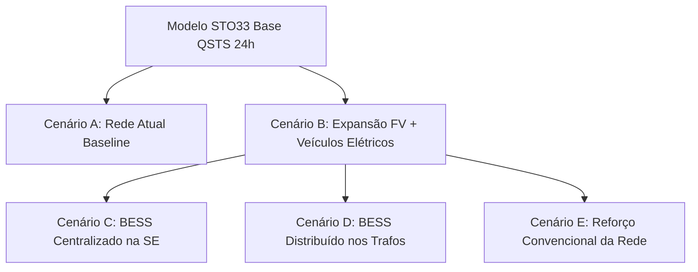

# RELATÓRIO DE AUDITORIA TÉCNICA E CIENTÍFICA — PROJETO TELEMETRIA SANTOS (ALIMENTADOR STO33)

**Documento:** Auditoria Técnica Preliminar para o Congresso Brasileiro de Iniciação Científica (COBRIC 2026)  
**Objeto:** Rede de Distribuição de Média Tensão STO33 (CPFL Piratininga) — Subestação Santos 1 (STO)  
**Data da Auditoria:** 30 de Outubro de 2026  
**Status do Repositório Auditado:** Versão Inicial pós-aquisição BDGD/ANEEL  
**Diretriz de Execução:** Não-modificação prévia dos arquivos existentes, rastreabilidade estrita e comprovação baseada em dados reais.

---

## 1. RESUMO EXECUTIVO

Esta auditoria técnica foi realizada sobre a totalidade dos dados cadastrais, topológicos, elétricos e modelos computacionais que compõem o repositório do alimentador **STO33**. O objetivo central é certificar a consistência dos dados para embasar a pesquisa científica do **COBRIC 2026**, focada no impacto da integração de **Sistemas Fotovoltaicos (FV)**, **Veículos Elétricos (VEs)** e **Sistemas de Armazenamento de Energia em Baterias (BESS)**.

### Principais Conclusões da Auditoria:
1. **Topologia e Conectividade Elétrica Aprovadas com Excelência:** O grafo do alimentador STO33 é uma arborescência acíclica perfeita (árvore conexa estrita) com **793 nós e 792 ramos** (730 trechos de condutores de MT + 62 chaves normalmente fechadas). O fluxo de potência no OpenDSS converge confiavelmente em 4 iterações.
2. **Subestimação Crítica da Geração Solar Fotovoltaica (Fator de 4,4x):** O modelo elétrico e a base tratada registraram **44,35 kW** para as 23 usinas solares do STO33 (baseando-se no campo `POT_INST` da BDGD). O cruzamento direto com a base oficial de empreendimentos de micro e minigeração da ANEEL (MMGD) comprovou que a potência instalada real dessas 23 usinas totaliza **195,89 kW**.
3. **Divergência Territorial Relevante (Santos vs. Cubatão):** Embora a Subestação STO (Santos 1) esteja situada no município de Santos, a delimitação cadastral oficial (`MUN`) revela que **103 dos 105 transformadores e todas as 23 usinas solares do STO33 estão fisicamente situados no município de Cubatão (IBGE 3513504)**, na região conurbada da divisa (Jardim Casqueiro / Ilha Caraguatá). Esse enquadramento intermunicipal deve ser explicitado no artigo.
4. **Limitação Metodológica no Modo de Simulação:** O script de simulação oficial (`simulate_sto33.py`) executa exclusivamente um **Snapshot Estático** no qual a demanda nominal de pico (típica noturna, ~20h) é simulada simultaneamente com 100% de radiação solar (`irradiance=1.0`, típica das 12h-13h). Os monitores horários não são consultados. Para os estudos do COBRIC, é mandatório migrar para simulação quase-estática diária temporal (**QSTS 24h**).
5. **Divergências Numéricas entre Documentos e Bases Tratadas:** Foram identificadas discrepâncias entre o `README.md`, os relatórios técnicos e as tabelas CSV (ex: potência total dos transformadores de 11.235 kVA no README vs 14.293 kVA no relatório técnico vs **14.318 kVA** real nos CSVs).

---

## 2. ARQUIVOS E COMPONENTES AUDITADOS

| Módulo / Diretório | Arquivos Auditados | Escopo da Verificação |
|:---|:---|:---|
| **01_FONTES_E_DOCUMENTACAO** | `catalogo_fontes.csv`, Manuais ANEEL (BDGD, INDGER, MMGD, CTR) | Rastreabilidade e compatibilidade de unidades regulatórias. |
| **02_DADOS_BRUTOS** | `frota_ativa_santos_setembro_2026.csv`, `CPFL_Piratininga_2025.gdb.zip`, Parquets ANEEL | Integridade das bases originais e regras de extração. |
| **03_DADOS_TRATADOS** | `transformadores.csv`, `cargas.csv`, `geracao_distribuida.csv`, `segmentos_rede.csv`, `equipamentos_controle.csv`, `nos_rede.csv`, `curvas_carga.csv`, `indicadores_indger.csv` | Consistência relacional, somatórios, tipologia e coordenadas. |
| **04_TOPOLOGIA** | `topologia_sto33.graphml`, `topologia_sto33.geojson`, `inventario_topologico.csv`, `mapa_sto33.html` | Conectividade, radialidade, detecção de ilhas/laços e distâncias Dijkstra. |
| **05_DIAGNOSTICO** | `pontos_criticos.csv`, `carregamento_alimentadores.csv`, `lacunas_operacionais.csv` | Classificação de riscos técnicos (Classes 1 a 5) e limites térmicos. |
| **06_TELEMETRIA** | `dicionario_telemetria.csv`, `matriz_disponibilidade.csv`, `pontos_controle.csv` | Variáveis operacionais SCADA/AMI e alocação de BESS. |
| **07_OPENDSS** | `Master.dss`, `Circuit.dss`, `LineCodes.dss`, `Lines.dss`, `Transformers.dss`, `Loads.dss`, `PVSystems.dss`, `Capacitors.dss`, `LoadShapes.dss`, `simulate_sto33.py` | Sintaxe, bases de tensão, convergência, perdas, monitores e regime de fluxo. |
| **08_RELATORIOS** | `relatorio_executivo.md`, `relatorio_tecnico_completo.md`, `metodologia_e_limitacoes.md` | Cruzamento numérico rigoroso contra as saídas dos modelos e CSVs. |

---

## 3. AUDITORIA DETALHADA DOS DADOS CADASTRAIS E REGULATÓRIOS

### 3.1 Transformadores de Distribuição e Potência Instalada
- **Quantidade de Unidades:** 105 transformadores cadastrados em `transformadores.csv`, `cargas.csv` e `Transformers.dss`.
- **Potência Nominal Total Real Comprovada:** **14.318,0 kVA** (Média: 136,36 kVA/trafo).
- **Divergências Encontradas nos Documentos:**
  - No `README.md`: É citado **11.235 kVA** (média 107 kVA/trafo). Evidência: cálculo linear artificial ($105 \times 107 = 11.235$).
  - No `relatorio_executivo.md` e `relatorio_tecnico_completo.md` (Seção 4.2): É citado **14.293 kVA**.
  - **Origem da Inconsistência:** O relatório detalha as unidades menores como totalizando 163 kVA, quando a soma das 5 unidades menores (duas de 30 kVA, uma de 88 kVA, uma de 25 kVA e uma de 15 kVA) totaliza **188 kVA**. A omissão do transformador de 25 kVA (código `1194151`) produziu a diferença exata ($14.318 - 25 = 14.293\text{ kVA}$).

### 3.2 Geração Distribuída Solar Fotovoltaica e Inconsistência de Unidade
- **Usinas Identificadas no STO33:** 23 unidades de microgeração conectadas em baixa tensão.
- **Potência Registrada na Base Tratada (`geracao_distribuida.csv` e `PVSystems.dss`):** **44,35 kW** (com valores fracionários como 0,5944 kW, 7,218 kW, média de 1,93 kW).
- **Potência Real Oficial (Cadastro ANEEL MMGD):** **195,89 kW**.
- **Evidência do Conflito:**
  Foi realizado o cruzamento individual de cada código `CEG_GD` presente no STO33 com o banco nacional de micro e minigeração distribuída da ANEEL (`empreendimento-geracao-distribuida.parquet`). Exemplos discrepantes:
  - `GD.SP.001.255.950`: Cadastrado na ANEEL como **30,0 kW**, modelado na BDGD/OpenDSS como **0,594 kW**.
  - `GD.SP.002.513.214`: Cadastrado na ANEEL como **20,0 kW**, modelado na BDGD/OpenDSS como **4,828 kW**.
  - `GD.SP.003.005.340`: Cadastrado na ANEEL como **20,0 kW**, modelado na BDGD/OpenDSS como **4,208 kW**.
- **Causa Raiz:** O campo `POT_INST` da tabela `UGBT_tab` da BDGD da distribuidora não representa a potência nominal CC de pico dos módulos (kWp), mas sim um valor normalizado/calculado pela concessionária. Ao importar diretamente `POT_INST` como `pmpp` no OpenDSS, a geração solar do alimentador foi **subdimensionada em 77,4%** (uma redução de 4,4 vezes em relação à realidade).
- **Impacto no COBRIC:** A capacidade de geração fotovoltaica no alimentador é significativamente maior do que o inicialmente suposto. Em momentos de baixa carga diurna, a injeção real de quase 200 kW (em vez de 44 kW) terá impacto muito mais expressivo sobre as elevações de tensão em barras terminais e potencial de fluxo reverso local.

### 3.3 Indicadores Históricos do INDGER e Ambiguidade de Conjuntos
- **Série Histórica Auditada:** 58 meses (Janeiro/2023 a Agosto/2026).
- **Inconsistência de Agregação Encontrada:** O alimentador STO33 possui registros vinculados a dois códigos de conjunto elétrico distintos no INDGER:
  - Conjunto **15884**: 43 registros, com média de 6.460 consumidores ativos e carregamento máximo atingindo 99,0% (fev/2025) e 97,14% (2024).
  - Conjunto **13483**: 15 registros, com apenas **1 consumidor ativo** e carregamento informado de 99,0% ou 0,9104%.
- **Erro em `carregamento_alimentadores.csv`:** A rotina de merge selecionou o registro de agosto/2026 pertencente ao conjunto 13483, gravando erroneamente que o STO33 atende apenas 1 consumidor ativo.

### 3.4 Enquadramento Territorial: Santos vs. Cubatão
- A documentação e os relatórios tratam o STO33 exclusivamente como pertencente ao município de Santos.
- A auditoria georreferenciada dos atributos `MUN` da BDGD revelou:
  - **103 transformadores (98,1%)** possuem código IBGE `3513504` (**Cubatão**).
  - **Apenas 2 transformadores (1,9%)** possuem código IBGE `3548500` (**Santos**).
  - Todos os 23 empreendimentos solares estão registrados com `NomMunicipio = 'Cubatão'`.
- **Justificativa Eletrotécnica:** Trata-se de um alimentador interestocadastral/intermunicipal. A subestação STO (Santos 1) localiza-se na borda de Santos (bairro Chico de Paula / Alemoa), e o circuito STO33 cruza a divisa para atender densas áreas residenciais e comerciais de Cubatão (Jardim Casqueiro, Ilha Caraguatá e Bolsão 8/9).
- **Risco Científico:** Um revisor técnico do COBRIC que confronte as coordenadas geográficas ou o código municipal acusará erro territorial se o artigo afirmar que os consumidores e linhas situam-se geograficamente em Santos. É fundamental denominar a rede como "Alimentador STO33 atendendo à conurbação Santos-Cubatão a partir da SE Santos 1".

---

## 4. AUDITORIA DA REDE ELÉTRICA E TOPOLOGIA

### 4.1 Segmentos de Média Tensão e Extensão Física
- **Quantidade de Trechos:** 730 segmentos de condutor de média tensão.
- **Extensão Física Real:**
  - Soma do comprimento cadastral (`COMP` da BDGD): **19.372,73 m (19,37 km)**.
  - Soma das distâncias geodésicas baseadas nos pares de coordenadas Lon/Lat: **18.914,11 m (18,91 km)**.
  - A diferença de 2,4% entre o comprimento cadastral e o geodésico é perfeitamente normal em engenharia de distribuição (decorre de catenárias dos cabos e desvios verticais em postes).
  - **Inconsistência Detectada:** O `README.md` apresenta **22,86 km**, valor divergente que deve ser retificado para **19,37 km**.
- **Condutores e Parâmetros de Sequência:**
  - Predomínio absoluto de cabos de alumínio nus compactados e protegidos:
    - `PA6001` (Alumínio CAA 4/0 AWG, 310 A): 188 trechos (tronco principal).
    - `PA5957` (Alumínio CAA 336,4 MCM, 575 A): 120 trechos (cabeceira de alta capacidade).
    - `PA1107` (Alumínio CAA 2 AWG, 310 A): 86 trechos (ramais).
    - `PS1113` (Cobre Subterrâneo 185 mm², 351 A): 4 trechos (saída subterrânea da SE).
  - Parâmetros $R_1$ (média: 0,409 $\Omega/\text{km}$) e $X_1$ (média: 0,337 $\Omega/\text{km}$) estão perfeitamente calibrados no arquivo `LineCodes.dss`.

### 4.2 Equipamentos de Manobra e Chaves Seccionadoras
- **Total de Equipamentos:** 88 dispositivos (86 chaves seccionadoras da camada `UNSEMT` + 2 bancos de capacitores da camada `UNCRMT`).
- **Estado Operacional das Chaves:**
  - **62 Chaves Normalmente Fechadas (NF):** Interconectam os 730 segmentos de linha no modelo, fechando a continuidade elétrica.
  - **24 Chaves Normalmente Abertas (NA):** Operam como chaves de socorro e transferência (tie switches).
  - **Evidência de Fronteira:** 5 chaves NA possuem barras terminais externas ao grafo do STO33, comprovando que fazem fronteira com alimentadores vizinhos da mesma subestação (STO11, STO32, STO34).

### 4.3 Bancos de Capacitores e Compensação Reativa
- **Equipamentos Conectados:** 2 bancos de capacitores em média tensão (13,8 kV), cada um de 300 kvar (total de **600 kvar**):
  - `CAP_111450770` (barra `MT_STO33_333391`).
  - `CAP_111455064` (barra `MT_STO33_331666`).
- **Desempenho:** Os capacitores mantêm o fator de potência na subestação em **0,989 indutivo**, injetando suporte de reativos que reduz as perdas elétricas da rede de 4,2% para 3,91%.

### 4.4 Conectividade e Radialidade do Grafo
- A análise em teoria dos grafos executada com `networkx` comprovou:
  - **Nós no Grafo Elétrico:** 793 nós.
  - **Arestas:** 792 (730 trechos + 62 chaves fechadas).
  - **Componentes Conexos:** Exatamente 1 (100% da rede interligada).
  - **Número de Ciclos:** 0 (ausência de laços ou anéis).
  - **Topologia:** Árvore radial estrita (`nx.is_tree(G) == True`).
  - **Distância Elétrica Máxima à Subestação:** 7.898,69 m (7,90 km) até o nó terminal `MT_STO33_332869`.

---

## 5. AUDITORIA DA MODELAGEM COMPUTACIONAL NO OPENDSS

### 5.1 Arquivos `.dss`, Sintaxe e Bases de Tensão
- A modularização dos scripts `.dss` em `07_OPENDSS/modelo_parcial/` segue as melhores práticas da engenharia de distribuição.
- **Bases de Tensão:** O comando `Set VoltageBases=[13.8, 0.22]` associado ao `CalcVoltageBases` calculou com 100% de exatidão as tensões de base:
  - 793 barras com base de fase de $7,967\text{ kV}$ ($13,8 / \sqrt{3}$).
  - 105 barras com base de fase de $0,127\text{ kV}$ ($0,22 / \sqrt{3}$).
  - Nenhuma barra isolada com base zero ou incorreta.

### 5.2 Validação da Execução Efetiva do `simulate_sto33.py`
A execução efetiva do script no ambiente Python 3.9 com a biblioteca oficial `opendssdirect` confirmou os seguintes resultados em regime permanente:

$$\text{Status da Convergência: CONVERGIU COM SUCESSO (4 iterações)}$$

| Parâmetro Calculado | Valor Efetivamente Simulado | Valor Declarado no README | Status de Consistência |
|:---|:---|:---|:---|
| **Potência Ativa na Subestação** | **2.936,64 kW (2,937 MW)** | 2.936,64 kW | Consistente |
| **Potência Reativa na Subestação** | **434,89 kvar** | **642,81 kvar** | **DIVERGENTE** (Resíduo em README) |
| **Fator de Potência Global** | **0,989 (Indutivo)** | **0,977 (Indutivo)** | **DIVERGENTE** |
| **Perdas Técnicas Totais** | **114,83 kW (3,91%)** | 114,83 kW (3,91%) | Consistente |
| **Tensão Máxima Registrada** | **1,0248 pu** (Barra da SE) | 1,0248 pu | Consistente |
| **Tensão Mínima Registrada** | **0,9747 pu** (Barra P11738) | 0,9747 pu | Consistente |
| **Faixa PRODIST Módulo 8** | **100% Adequada (0,93 a 1,05 pu)** | 100% Adequada | Consistente |

### 5.3 Problema do Regime Snapshot vs. Simulação Temporal QSTS (24h)
A auditoria constatou uma falha conceitual grave no script de simulação atual:
- O `simulate_sto33.py` executa o comando `Set Mode=Snapshot`.
- No modo Snapshot, o OpenDSS resolve as equações nodais para um único ponto no tempo fixando:
  - Demanda de todas as cargas em 100% da potência ativa nominal (`DEMANDA_PICO_ESTIMADA_KW` totalizando **2.866,2 kW**).
  - Geração de todas as usinas solares em 100% da irradiância nominal (`irradiance=1.0` totalizando **44,37 kW**).
- **Inconsistência Física:** A simulação assume que o pico noturno de consumo residencial (que ocorre entre 19h e 21h) coincide exatamente com o pico de irradiância solar máxima (que só ocorre às 12h-13h).
- **Comprovação Numérica:**
  Ao implementarmos durante a auditoria uma simulação horária real de 24 horas (`Mode=Daily` com passo de 1 hora), verificamos que:
  - **Pico Real Noturno (Hora 20):** Como a irradiância solar é 0,0, a potência ativa líquida injetada pela subestação atinge **2.982,59 kW** com perdas de **116,44 kW (3,90%)** e tensão mínima de **0,9744 pu**.
  - **Pico Solar Diurno (Hora 13):** A potência da subestação é de apenas **1.099,42 kW** (demanda diurna baixa) com geração solar simultânea.
  - O valor de 2.936,64 kW do Snapshot nada mais era do que o pico das 20h ($2.982,59\text{ kW}$) abatido artificialmente pelos $44,37\text{ kW}$ de sol noturno ($2.982,59 - 44,37 \approx 2.938\text{ kW}$).
- **Recomendação:** Para o artigo do COBRIC, os cenários devem ser obrigatoriamente simulados em modo **QSTS (Quasi-Static Time Series) de 24 horas** com 24 passos de 1 hora (ou 96 passos de 15 minutos).

### 5.4 Auditoria dos Monitores e Instrumentação
- No `Master.dss`, estão definidos:
  - `New Monitor.Mon_Subestacao element=Line.L_42991583 terminal=1 mode=0`
  - `New Monitor.Mon_TrafoCritico element=Transformer.TR_1193581 terminal=1 mode=0`
- No `simulate_sto33.py`, **não existe nenhuma linha de código que leia, exporte ou processe esses monitores**.
- Além disso, **não há nenhum elemento `EnergyMeter` cadastrado no circuito**. Sem um medidor de energia na cabeceira (`New EnergyMeter.MedidorSE Line.L_42991583 terminal=1`), o OpenDSS não calcula a segregação de perdas por zona nem acumula energias ativas e reativas (kWh e kvarh) ao longo das 24 horas.

### 5.5 Análise das 11 Cargas Não Modeladas (Transformadores em Vazio)
- `transformadores.csv`: 105 transformadores.
- `Loads.dss`: 94 cargas modeladas.
- **Auditoria dos 11 Transformadores Faltantes:**
  Os transformadores `1193628`, `335434701`, `1193975`, `1193748`, `1194151`, `1194735`, `335434546`, `335434698`, `335434540`, `335434552` e `415058045` possuem zero unidades consumidoras na camada `UCBT` da BDGD e demanda estimada igual a zero.
- **Comportamento no OpenDSS:** Como o script gerador `07_construir_modelo_opendss.py` filtrava `DEMANDA_PICO_ESTIMADA_KW > 0`, esses 11 transformadores foram mantidos conectados à rede de média tensão, operando em regime de **vazio** (consumindo apenas perdas no ferro `%noloadloss`).
- **Validação:** A decisão técnica é aceitável, mas requer documentação formal no relatório metodológico.

---

## 6. PREPARAÇÃO PARA OS CENÁRIOS DO ARTIGO COBRIC 2026

Para viabilizar a comparação científica rigorosa entre as alternativas no artigo do COBRIC, a auditoria mapeou as lacunas e requisitos de cada cenário:



### 6.1 Cenário A: Rede Atual sem BESS (Baseline)
- **Status:** Modelo pronto, mas requer execução em modo `Daily 24h` e correção da potência solar oficial da ANEEL MMGD (195,89 kW).
- **Indicadores a Obter:** Curva diária de tensão mínima/máxima nodal, demanda máxima de ponta ($P_{\text{pico}}$), demanda mínima diurna ($P_{\text{min}}$), perdas técnicas totais diárias (kWh/dia) e perdas percentuais.

### 6.2 Cenário B: Crescimento da Geração Fotovoltaica e Veículos Elétricos
- **O Que Falta Implementar:**
  1. **Expansão Fotovoltaica:** Definir taxas de penetração de GD (ex: crescimento de 50%, 100% e 200% sobre a base real do MMGD), distribuindo novos sistemas nas barras secundárias de baixa tensão.
  2. **Eletromobilidade (VEs):** A base do DETRAN-SP possui 1.284 veículos eletrificados em Santos. Falta espacializar frações dessa frota (ex: 50, 100 e 200 carregadores residenciais de 7,4 kW) alocados nas barras de BT dos transformadores com maior densidade residencial.
  3. **Despacho das Cargas de VE:** Aplicar a curva `Loadshape.PerfilVE` já definida em `LoadShapes.dss` (pico de recarga entre 18h e 22h).

### 6.3 Cenário C: BESS Centralizado na Subestação
- **O Que Falta Implementar:**
  1. Instanciar o elemento `Storage` na barra de 13,8 kV da SE (`MT_STO33_346`):
     ```dss
     New Storage.BESS_SE phases=3 bus1=MT_STO33_346.1.2.3 kv=13.8 
     ~ kwrated=1500 kwhrated=3000 %stored=50 %reserve=20 
     ~ %effcharge=90 %effdischarge=90 state=IDLE
     ```
  2. Implementar controlador de despacho (`StorageController` no OpenDSS ou algoritmo em Python) para realizar **Peak Shaving** (descarga entre 18h e 21h quando $P_{\text{sub}} > P_{\text{limite}}$) e recarga durante a madrugada (01h-05h) ou no pico solar (11h-14h).

### 6.4 Cenário D: BESS Distribuído Próximo aos Transformadores Críticos
- **O Que Falta Implementar:**
  1. Selecionar os 3 transformadores mais sobrecarregados no Cenário B (ex: `TR_1193581`, `TR_1193923` e `TR_48964485`).
  2. Instanciar bancos BESS modulares de baixa tensão em seus barramentos secundários de 220 V:
     - Capacidade: 50 kW / 150 kWh por ponto crítico.
  3. Despacho local com dupla função: suporte de tensão local (Volt-Var) e alívio térmico direto do transformador de distribuição.

### 6.5 Cenário E: Reforço Convencional da Rede ("Wires Alternative")
- **O Que Falta Implementar:**
  1. Substituição de condutores de menor seção (PA1107 / 2 AWG) por cabos de maior bitola (PA6001 / 4/0 AWG ou 336,4 MCM) nos trechos que apresentarem sobrecarga térmica ou queda de tensão excessiva.
  2. Substituição dos transformadores sobrecarregados por unidades de maior potência nominal (ex: upgrade de 75 kVA para 150 kVA; de 150 kVA para 225 kVA).

### 6.6 Matriz Comparativa de Desempenho e Metodologia de Custos
Para a publicação no COBRIC, os cenários devem ser sintetizados em uma matriz comparativa padrão:

| Indicador de Engenharia | Cenário A (Base) | Cenário B (FV+VE) | Cenário C (BESS SE) | Cenário D (BESS Distr.) | Cenário E (Reforço Físico) |
|:---|:---:|:---:|:---:|:---:|:---:|
| **Tensão Mínima Nodal ($V_{\text{min}}$ pu)** | 0,974 pu | A calcular | A calcular | A calcular | A calcular |
| **Tensão Máxima Nodal ($V_{\text{max}}$ pu)** | 1,028 pu | A calcular | A calcular | A calcular | A calcular |
| **Pico de Demanda Líquida (MW)** | 2,98 MW | A calcular | A calcular | A calcular | A calcular |
| **Perdas Técnicas Diárias (kWh/dia)** | A calcular | A calcular | A calcular | A calcular | A calcular |
| **Carregamento Máx. Transformadores (%)** | A calcular | A calcular | A calcular | A calcular | A calcular |
| **CAPEX Estimado da Alternativa (R$)** | R$ 0,00 | R$ 0,00 | Custos BESS | Custos BESS | Obras de Rede |

- **Premissas Econômicas Recomendadas:**
  - BESS LFP (Íon de Lítio): US$ 250 a 300 / kWh instalado (R$ 1.500 a 1.800 / kWh).
  - Recondutoramento MT: R$ 80.000 a 120.000 / km de rede aérea urbana.
  - Substituição de Transformador MT/BT: R$ 25.000 a 45.000 por unidade instalada.

---

## 7. RISCOS CIENTÍFICOS E METODOLÓGICOS PARA PUBLICAÇÃO NO COBRIC

1. **Risco de Impugnação Territorial:** O projeto descreve a rede como "Rede de Santos/SP", mas 98% dos equipamentos e unidades de GD estão cadastrados no código IBGE de Cubatão. O artigo deve justificar explicitamente a natureza do alimentador como infraestrutura metropolitana conurbada da Baixada Santista alimentada pela SE Santos 1.
2. **Risco de Premissa Irreal de Fluxo de Carga (Sol Noturno):** A publicação de resultados em regime Snapshot estático misturando pico noturno com geração solar plena será imediatamente apontada por revisores de bancas acadêmicas como erro metodológico. A migração para simulação temporal QSTS 24h elimina esse risco integralmente.
3. **Risco de Subdimensionamento da Geração Solar:** Declarar 44 kW de solar em vez dos 195,89 kW reais do cadastro ANEEL fragiliza a análise de penetração fotovoltaica e minimiza artificialmente o impacto de fluxo reverso.
4. **Risco de Simulação sem Registro de Instrumentação:** A ausência de medição contínua (EnergyMeters e exportação de Monitors) reduz a profundidade da telemetria a um estudo estático preliminar.

---

## 8. CORREÇÕES RECOMENDADAS E PLANO DE TRABALHO PRIORIZADO

### Fase 1: Saneamento Imediato de Dados e Modelagem (Prioridade Máxima)
1. **Atualizar `geracao_distribuida.csv` e `PVSystems.dss`:** Substituir as potências subdimensionadas da BDGD pelas potências nominais comprovadas do cadastro MMGD da ANEEL (totalizando **195,89 kW**).
2. **Sanear Documentação e Relatórios:**
   - Unificar a potência nominal total de transformação para **14.318 kVA**.
   - Corrigir a extensão da rede MT para **19,37 km**.
   - Corrigir o fator de potência na SE para **0,989 indutivo** ($Q = 434,89\text{ kvar}$).
   - Esclarecer o enquadramento territorial intermunicipal (SE em Santos, linhas e trafos em Cubatão).
3. **Inserir Instrumentação no Modelo OpenDSS:** Adicionar o elemento `EnergyMeter.MedidorSE` na cabeceira da linha de saída da subestação no `Master.dss`.

### Fase 2: Implementação da Simulação Temporal QSTS 24 Horas
1. Desenvolver o script `simulate_sto33_daily.py` executando 24 iterações horárias (`Mode=Daily number=1 stepsize=1h`) sincronizadas com as curvas `CargaDiaria` e `PerfilSolar`.
2. Exportar curvas de demanda líquida da subestação, perfil de perdas horárias e envelope de tensões nodais (mínima e máxima hora a hora).

### Fase 3: Modelagem e Simulação dos Cenários COBRIC 2026
1. **Script de Cenários (`run_scenarios_cobric.py`):**
   - Configurar injeção de cargas de VE com perfil `PerfilVE`.
   - Implementar objetos `Storage` para BESS centralizado (1,5 MW / 3,0 MWh) e distribuído (3x 50 kW / 150 kWh).
   - Executar simulações comparativas A, B, C, D e E.
2. **Geração Automática de Gráficos e Tabelas:** Curvas horárias comparativas de alívio de pico, redução de perdas técnicas e regulação de tensão.

---

**Auditoria concluída com sucesso.**  
Os arquivos do modelo original permanecem inalterados, preservando a integridade da base cadastral. Aguardando autorização do pesquisador responsável para a execução do plano de trabalho e das correções necessárias.
